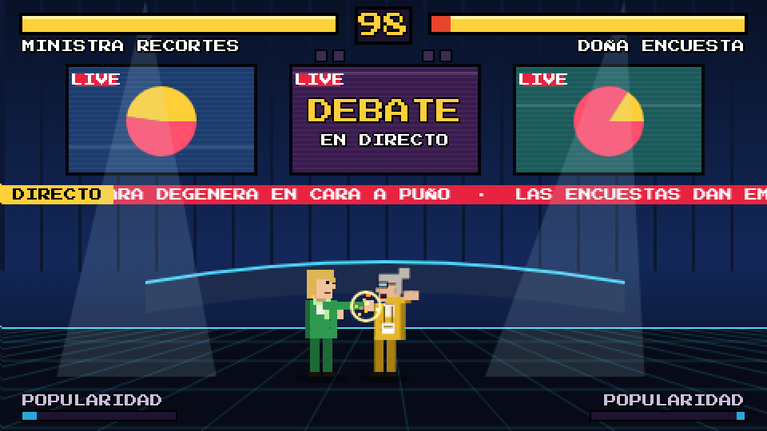
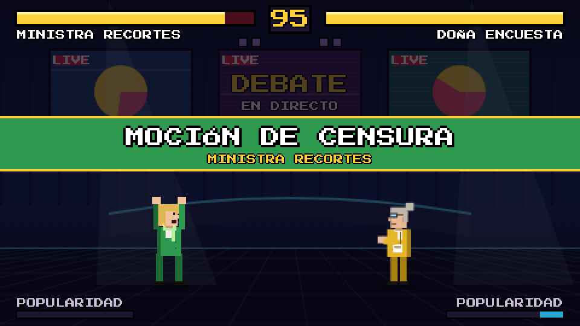
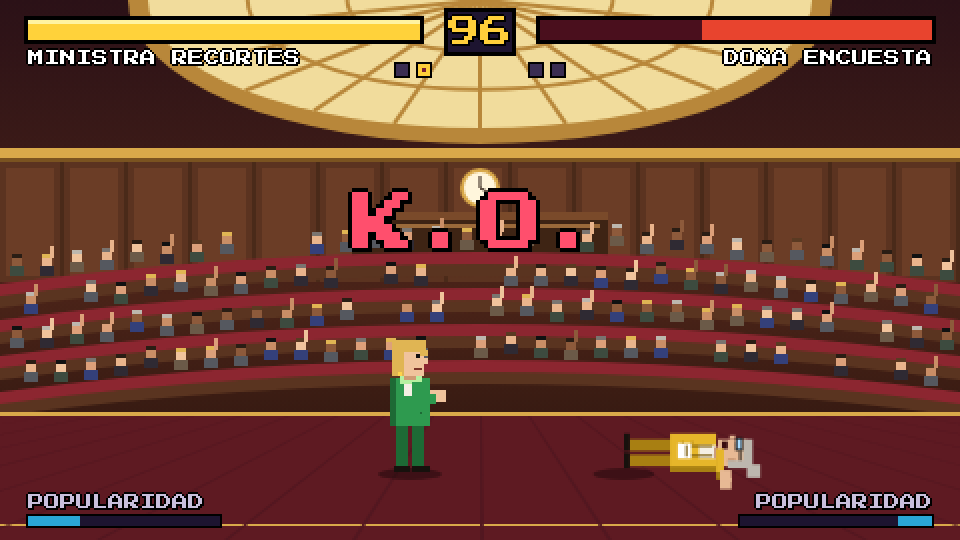
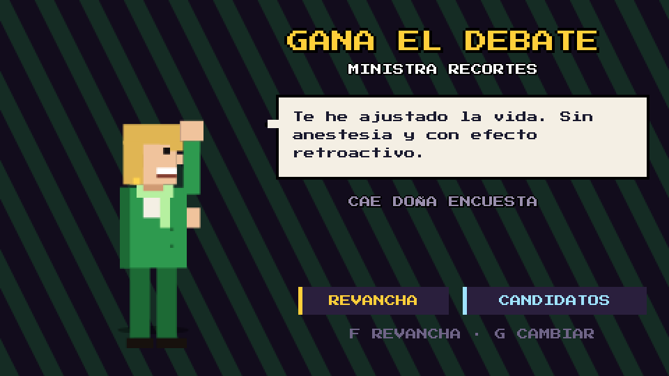

<div align="center">

# 🥊 Hemiciclo Fighters

**Cuatro candidatos. Un hemiciclo. Ninguna propuesta.**

Juego de lucha 2D al estilo de las recreativas de los 90, con políticos ficticios y golpes especiales sacados del día a día parlamentario.

[](https://serbenda.github.io/hemiciclo-fighters/)


<br><br>


</div>

---

## Índice

- [Cómo se juega](#cómo-se-juega)
- [Capturas](#capturas)
- [Candidatos](#candidatos)
- [Controles](#controles)
- [En el móvil](#en-el-móvil)
- [Reglas del combate](#reglas-del-combate)
- [Ejecutar en local](#ejecutar-en-local)
- [Estructura del proyecto](#estructura-del-proyecto)
- [Flujo de trabajo](#flujo-de-trabajo)
- [Ideas para próximas versiones](#ideas-para-próximas-versiones)

## Cómo se juega

1. Elige modo: **1 jugador contra la CPU** o **2 jugadores** en el mismo teclado.
2. Escoge candidato.
3. Gana el debate llevándote **2 de 3 rondas**: deja al rival sin vida o termina con más vida cuando se acabe el tiempo.

Cada golpe que das o recibes llena tu barra de **Popularidad**. Cuando está llena, puedes lanzar la **Moción de Censura**: una urna gigante cae del cielo sobre tu rival.

## Capturas

<table>
<tr>
<td width="50%"><br><sub><b>Título.</b> Elige entre 1 jugador contra la CPU o 2 jugadores.</sub></td>
<td width="50%"><br><sub><b>Selección.</b> Cada candidato tiene sus estadísticas y su especial.</sub></td>
</tr>
<tr>
<td><br><sub><b>El plató.</b> Segundo escenario, con monitores y teletipo en directo.</sub></td>
<td><br><sub><b>Moción de Censura.</b> La super, cuando la barra de Popularidad está llena.</sub></td>
</tr>
<tr>
<td><br><sub><b>K.O.</b> En el hemiciclo, con la bancada en pie.</sub></td>
<td><br><sub><b>Victoria.</b> Cada candidato tiene su frase para celebrarlo.</sub></td>
</tr>
</table>

<p align="center"><br><sub><b>En el móvil.</b> Cruceta a la izquierda y botones a la derecha.</sub></p>

## Candidatos

| | Candidato | Especial | Velocidad | Pegada | Aguante |
|---|---|---|:---:|:---:|:---:|
| 🔵 | **Don Promesas** | *Promesa Electoral*: lanza un bocadillo con una promesa que golpea al llegar | ★★★☆☆ | ★★★☆☆ | ★★★☆☆ |
| 🟢 | **Ministra Recortes** | *Tijeretazo*: unas tijeras giratorias que cruzan la pantalla | ★★★★☆ | ★★★☆☆ | ★★☆☆☆ |
| 🔴 | **El Barón** | *Puerta Giratoria*: embestida girando dentro de una puerta giratoria que derriba | ★★☆☆☆ | ★★★★★ | ★★★★★ |
| 🟡 | **Doña Encuesta** | *Cocina de Encuestas*: unas barras de sondeo brotan del suelo delante del rival | ★★★★★ | ★★☆☆☆ | ★★☆☆☆ |

> **Don Promesas.** Lleva treinta años prometiendo lo mismo. Y le sigue funcionando.
>
> **Ministra Recortes.** Si no está en el presupuesto, no existe. Y tú tampoco.
>
> **El Barón.** Manda en su provincia desde antes de que existieran las provincias.
>
> **Doña Encuesta.** Te dice quién va a ganar antes de que nadie haya votado.

## Controles

### Teclado

| Acción | Jugador 1 | Jugador 2 |
|---|:---:|:---:|
| Moverse | `A` `D` | `←` `→` |
| Saltar | `W` | `↑` |
| Agacharse | `S` | `↓` |
| Puño | `F` | `K` |
| Patada | `G` | `L` |
| Especial | `H` | `O` |
| Super | `J` | `P` |
| Pausa | `Esc` | `Esc` |

Jugando contra la CPU, el jugador 1 también puede usar las flechas y `Z` `X` `C` `V`.

### Movimientos

| Movimiento | Cómo |
|---|---|
| Cubrirse | Mantén **hacia atrás** (de pie o agachado) |
| Barrido | **Agachado + patada**: derriba al rival |
| Puño bajo | **Agachado + puño** |
| Patada aérea | **Salta + puño o patada** |
| Moción de Censura | **Super** con la barra de Popularidad llena |

## En el móvil

- Se juega mejor **en horizontal**: la cruceta queda a la izquierda, la pantalla en el centro y los botones a la derecha.
- La **cruceta se desliza**: mantén el dedo y muévelo para andar, saltar en diagonal o agacharte sin levantarlo.
- **Toca el reloj** para pausar. El juego también se pausa solo si cambias de app.
- En **Android**, el botón **AMPLIAR** pone el juego a pantalla completa.
- En **iPhone**, usa *Compartir → Añadir a pantalla de inicio* para abrirlo sin las barras del navegador.

En el móvil solo está disponible el modo de 1 jugador.

## Reglas del combate

| | |
|---|---|
| Rondas | Al mejor de 3 |
| Tiempo por ronda | 99 segundos |
| Fin por tiempo | Gana quien tenga más vida; con la misma vida es **empate técnico** |
| Victoria sin recibir daño | **¡Mayoría absoluta!** |
| Golpes cubiertos | Los especiales y la super hacen algo de daño aunque te cubras |
| Derribos | Barrido, Puerta Giratoria, Cocina de Encuestas, Moción de Censura y cualquier golpe en el aire |

## Ejecutar en local

No necesita instalación, servidor ni conexión (salvo para cargar la tipografía).

```bash
git clone https://github.com/serbenda/hemiciclo-fighters.git
cd hemiciclo-fighters
# abre index.html en el navegador
```

Para probarlo en el móvil desde tu red local, sírvelo y abre la IP de tu ordenador:

```bash
python3 -m http.server 8000
# http://localhost:8000
```

## Estructura del proyecto

```
hemiciclo-fighters/
├── index.html      # el juego completo: estilos, interfaz y lógica
├── docs/img/       # capturas y GIF del README
└── README.md
```

Todo está en un único `index.html`, sin librerías ni imágenes externas. Los personajes, escenarios y efectos se dibujan con Canvas 2D a 480×270 píxeles y se escalan con `image-rendering: pixelated`. El sonido se genera con Web Audio. La tipografía es [Press Start 2P](https://fonts.google.com/specimen/Press+Start+2P).

## Flujo de trabajo

| Rama | Uso |
|---|---|
| `main` | Versión publicada en GitHub Pages |
| `development` | Desarrollo; los cambios llegan a `main` mediante pull request |

1. Trabaja en `development` (o en una rama que salga de ella).
2. Abre una PR `development → main`.
3. Al fusionarla, GitHub Pages publica la nueva versión.

## Escenarios

| Escenario | Detalles |
|---|---|
| **El hemiciclo** | Claraboya, reloj, mesa de la presidencia y una bancada que se levanta con cada golpe fuerte |
| **El plató** | Monitores con gráficos en directo, focos y un teletipo con las últimas noticias del cara a cara |

El escenario se elige al azar en cada combate.

## Ideas para próximas versiones

- [ ] Editor de candidatos: nombre, colores, peinado y frases
- [ ] Más escenarios: pleno del Senado, mitin en la plaza del pueblo, plató de tertulia nocturna
- [ ] Niveles de dificultad de la CPU
- [ ] Modo campaña: ganar a todos los candidatos seguidos
- [ ] Combos y movimientos con secuencias de botones
- [ ] Música de fondo

---

<div align="center">

Personajes ficticios. Cualquier parecido con la realidad es pura tertulia.

</div>
