<div align="center">

# 🥊 Hemiciclo Fighters

**Cuatro candidatos. Un hemiciclo. Ninguna propuesta.**

Juego de lucha 2D al estilo de las recreativas de los 90, con políticos ficticios, combos, golpes especiales y un jefe final que nunca se presenta a las elecciones.

[](https://serbenda.github.io/hemiciclo-fighters/)


<br><br>

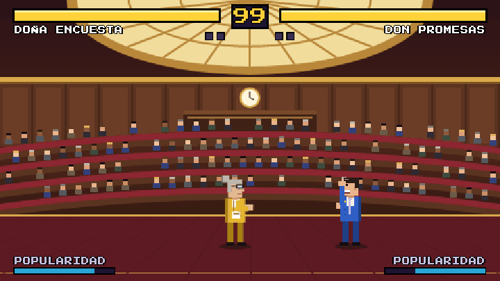

</div>

---

## Índice

- [Novedades de la versión 2](#novedades-de-la-versión-2)
- [Modos de juego](#modos-de-juego)
- [Capturas](#capturas)
- [Candidatos](#candidatos)
- [Controles](#controles)
- [Combos y movimientos](#combos-y-movimientos)
- [En el móvil](#en-el-móvil)
- [Reglas del combate](#reglas-del-combate)
- [Escenarios](#escenarios)
- [Instalar como app](#instalar-como-app)
- [Ejecutar en local](#ejecutar-en-local)
- [Cómo está hecho](#cómo-está-hecho)
- [Flujo de trabajo](#flujo-de-trabajo)

## Novedades de la versión 2

- **Golpes con peso**: cada impacto congela la acción un instante, más largo cuanto más fuerte es el golpe, con temblor de pantalla, destello y sonido distinto para golpes ligeros, fuertes y la super.
- **Combos** con contador en pantalla (`3 HITS`), encadenando puño → patada → especial. El daño baja un poco con cada golpe del combo.
- **Especiales con secuencia**: ↓↘→ + puño, como en las recreativas. Los botones de especial y super siguen funcionando.
- **Modo arcade** con jefe final secreto, fase de bonus, pantalla de continuar, puntuación y un final distinto para cada candidato.
- **CPU con tres niveles** de dificultad. En difícil se cubre, castiga los fallos, para los saltos y hace combos.
- **Música chiptune** propia para cada escenario y para el jefe, generada en el navegador.
- **Voz del presentador**: "Ronda uno", "¡A debate!", "¡K.O.!", "¡Mayoría absoluta!".
- **Nuevo escenario**: el mitin en la plaza del pueblo.
- **Más animación**: preparación y recuperación de cada golpe, dos tipos de caída y un público que se levanta con pancartas.
- **Opciones y récords** guardados en el dispositivo: dificultad, música, efectos, voces y tamaño de los botones táctiles.
- **Modo demo**: si nadie toca nada en el título, la CPU juega sola.
- **App instalable** que funciona sin conexión.

## Modos de juego

| Modo | Descripción |
|---|---|
| **Arcade** | Dos rivales, la fase de bonus del coche oficial, un tercer rival y el jefe final. Al perder puedes seguir a cambio de la mitad de los puntos. |
| **1 jugador vs CPU** | Un combate suelto contra un rival al azar. |
| **2 jugadores** | Dos personas en el mismo teclado. |
| **Demo** | Arranca sola en el título tras 15 segundos sin tocar nada. |

## Capturas

<table>
<tr>
<td width="50%">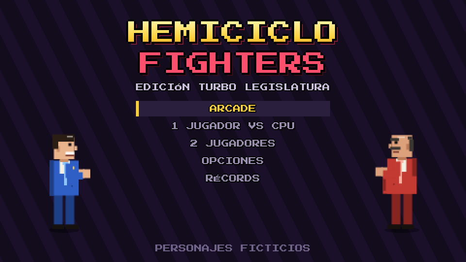<br><sub><b>Título.</b> Arcade, combate suelto, 2 jugadores, opciones y récords.</sub></td>
<td width="50%">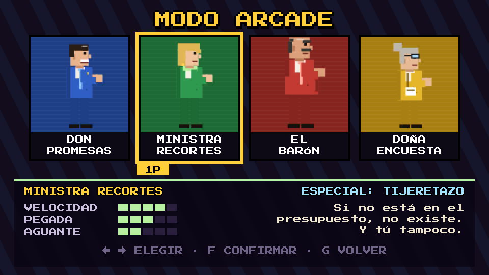<br><sub><b>Selección.</b> Estadísticas y especial de cada candidato.</sub></td>
</tr>
<tr>
<td>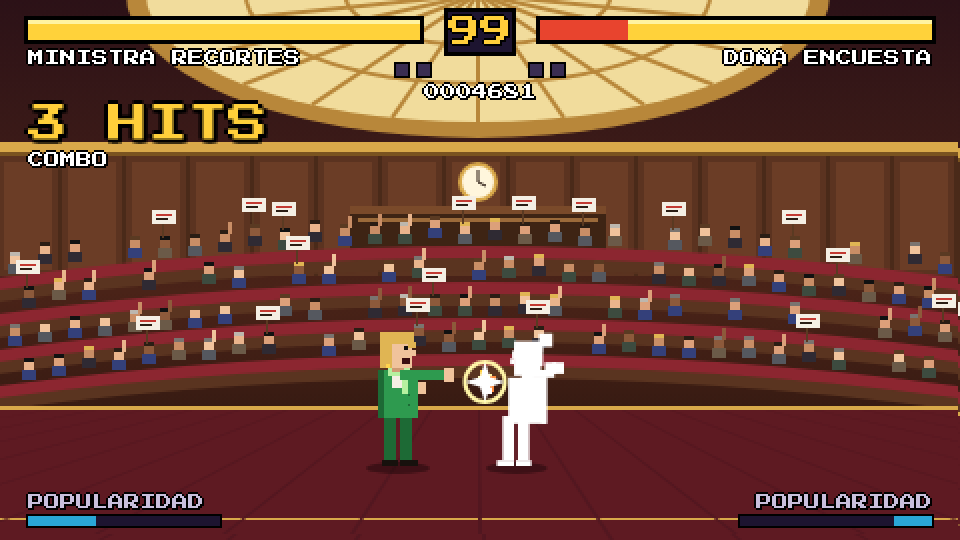<br><sub><b>Combos.</b> Puño, patada y especial: 3 HITS.</sub></td>
<td>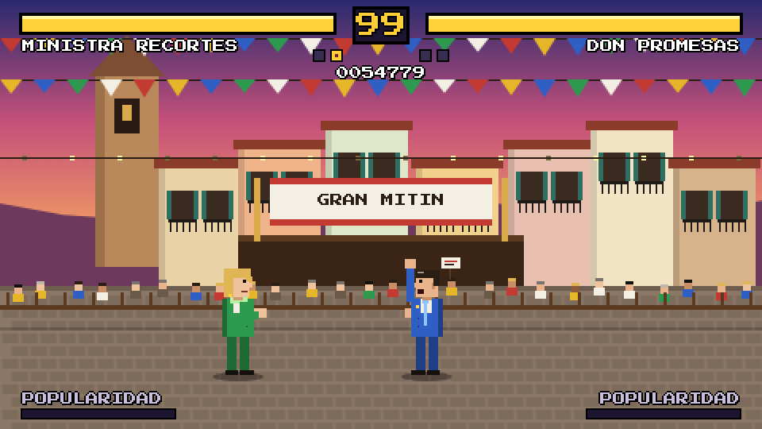<br><sub><b>La plaza.</b> El escenario nuevo, con guirnaldas y el mitin al fondo.</sub></td>
</tr>
<tr>
<td>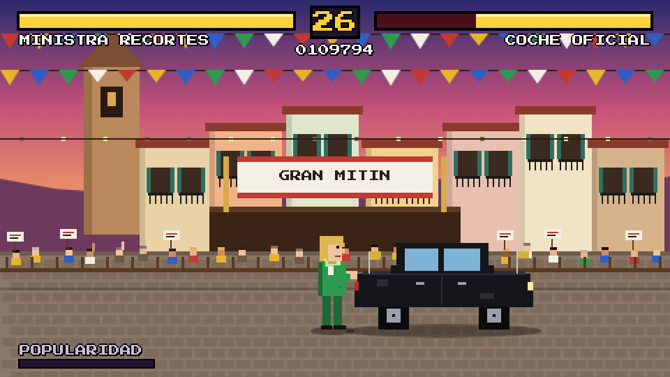<br><sub><b>Fase de bonus.</b> 30 segundos para destrozar el coche oficial.</sub></td>
<td>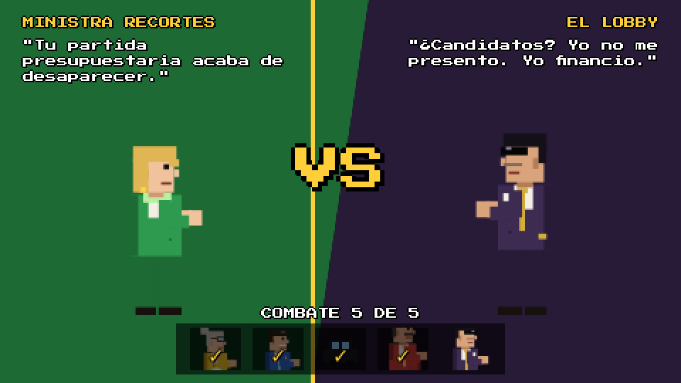<br><sub><b>El jefe final.</b> El Lobby aparece al final del arcade.</sub></td>
</tr>
<tr>
<td>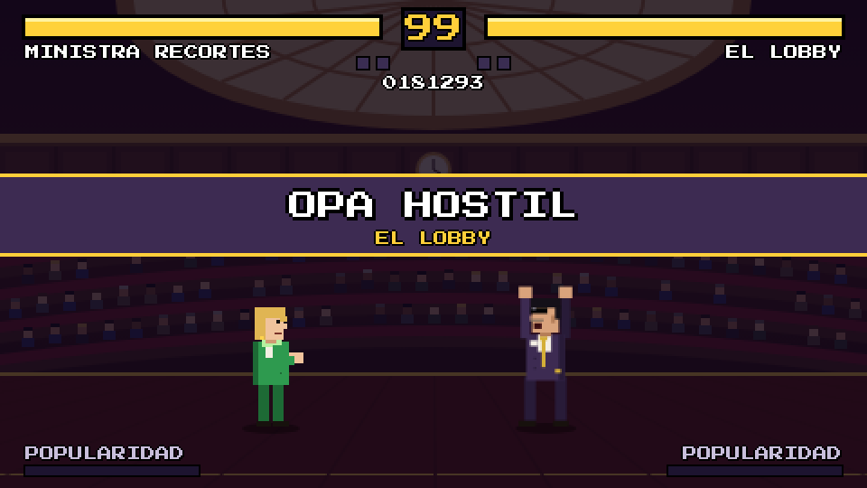<br><sub><b>Opa Hostil.</b> La super del jefe: una caja fuerte del cielo.</sub></td>
<td>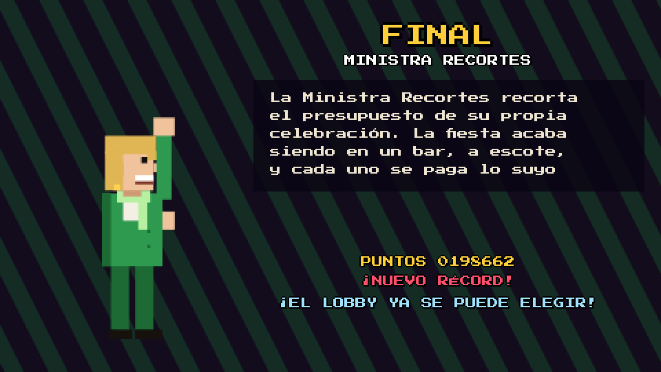<br><sub><b>Finales.</b> Cada candidato tiene el suyo.</sub></td>
</tr>
<tr>
<td>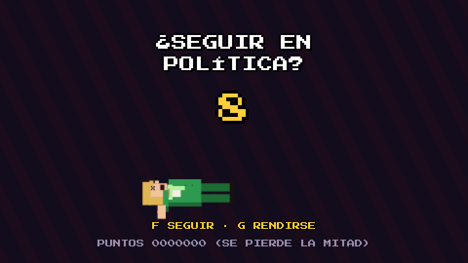<br><sub><b>¿Seguir en política?</b> Cuenta atrás para continuar.</sub></td>
<td>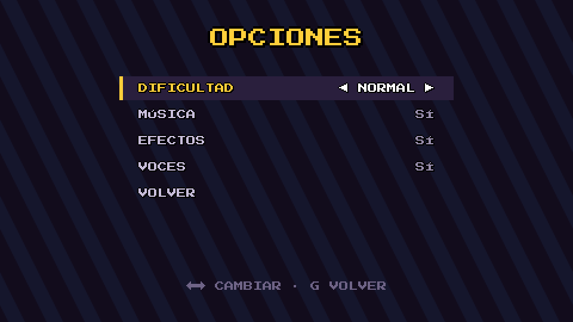<br><sub><b>Opciones.</b> Se guardan en el dispositivo.</sub></td>
</tr>
</table>

<p align="center">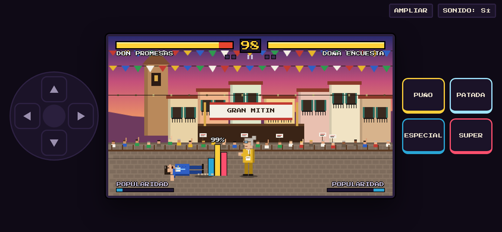<br><sub><b>En el móvil.</b> Cruceta a la izquierda y botones a la derecha.</sub></p>

## Candidatos

| | Candidato | Especial | Velocidad | Pegada | Aguante |
|---|---|---|:---:|:---:|:---:|
| 🔵 | **Don Promesas** | *Promesa Electoral*: lanza un bocadillo con una promesa | ★★★☆☆ | ★★★☆☆ | ★★★☆☆ |
| 🟢 | **Ministra Recortes** | *Tijeretazo*: unas tijeras giratorias que cruzan la pantalla | ★★★★☆ | ★★★☆☆ | ★★☆☆☆ |
| 🔴 | **El Barón** | *Puerta Giratoria*: embestida dentro de una puerta giratoria que derriba | ★★☆☆☆ | ★★★★★ | ★★★★★ |
| 🟡 | **Doña Encuesta** | *Cocina de Encuestas*: barras de sondeo que brotan del suelo | ★★★★★ | ★★☆☆☆ | ★★☆☆☆ |
| 🟣 | **El Lobby** *(secreto)* | *Maletín*: un maletín que suelta euros al golpear | ★★★★☆ | ★★★★☆ | ★★★★☆ |

Todos comparten la super **Moción de Censura**, una urna gigante que cae sobre el rival, menos El Lobby, que tiene la suya: **Opa Hostil**. El Lobby se desbloquea al completar el modo arcade con cualquier candidato.

> **Don Promesas.** Lleva treinta años prometiendo lo mismo. Y le sigue funcionando.
>
> **Ministra Recortes.** Si no está en el presupuesto, no existe. Y tú tampoco.
>
> **El Barón.** Manda en su provincia desde antes de que existieran las provincias.
>
> **Doña Encuesta.** Te dice quién va a ganar antes de que nadie haya votado.
>
> **El Lobby.** Nunca se presenta a las elecciones. No le hace falta.

## Controles

| Acción | Jugador 1 | Jugador 2 |
|---|:---:|:---:|
| Moverse | `A` `D` | `←` `→` |
| Saltar | `W` | `↑` |
| Agacharse | `S` | `↓` |
| Puño | `F` | `K` |
| Patada | `G` | `L` |
| Especial | `H` | `O` |
| Super | `J` | `P` |
| Pausa | `Esc` | `Esc` |

Jugando contra la CPU, el jugador 1 también puede usar las flechas y `Z` `X` `C` `V`.

## Combos y movimientos

| Movimiento | Cómo |
|---|---|
| Especial | `↓` `↘` `→` + puño, o el botón de especial |
| Especial (alternativo) | `↓` `↙` `←` + patada |
| Super | `↓` `↘` `→` `↓` `↘` `→` + puño con la barra llena, o el botón de super |
| Cubrirse | Mantén **hacia atrás** (de pie o agachado) |
| Barrido | **Agachado + patada**: derriba |
| Puño bajo | **Agachado + puño** |
| Patada aérea | **Salta + puño o patada** |

**Cómo encadenar:** si un golpe conecta, puedes cancelarlo en el siguiente antes de que el rival se recupere.

- Puño → puño → patada
- Puño → patada → especial
- Puño bajo → barrido
- Cualquier puño o patada → especial o super

Un salto con patada seguido de puño, patada y especial al aterrizar es el combo más largo que hay.

## En el móvil

- Se juega **en horizontal**: cruceta a la izquierda, pantalla en el centro y botones a la derecha.
- La **cruceta se desliza**: mantén el dedo y muévelo para andar, saltar en diagonal o agacharte. También sirve para las secuencias de especiales.
- **Toca el reloj** para pausar. El juego también se pausa solo si cambias de app.
- En **Opciones** puedes cambiar el tamaño de los botones.
- Los golpes **vibran** en Android.
- En el móvil solo están los modos de 1 jugador.

## Reglas del combate

| | |
|---|---|
| Rondas | Al mejor de 3 |
| Tiempo por ronda | 99 segundos |
| Fin por tiempo | Gana quien tenga más vida; con la misma vida es **empate técnico** |
| Victoria sin recibir daño | **¡Mayoría absoluta!** (30.000 puntos en arcade) |
| Golpes cubiertos | Los especiales y la super hacen algo de daño aunque te cubras |
| Derribos | Barrido, Puerta Giratoria, Cocina de Encuestas, las supers y cualquier golpe en el aire |
| Puntos (arcade) | Daño × combo, más vitalidad y tiempo restante al ganar cada ronda |

## Escenarios

| Escenario | Detalles |
|---|---|
| **El hemiciclo** | Claraboya, reloj, mesa de la presidencia y una bancada que se levanta con pancartas en cada golpe fuerte. Con luz morada cuando aparece el jefe. |
| **El plató** | Monitores con gráficos en directo, focos y un teletipo con las últimas noticias del cara a cara. |
| **La plaza** | Atardecer, iglesia con nido de cigüeña, guirnaldas, la tarima del mitin y el público detrás de la valla. |

Cada escenario tiene su propia música.

## Instalar como app

Desde la web publicada:

- **Android (Chrome)**: menú ⋮ → *Instalar aplicación* o *Añadir a pantalla de inicio*.
- **iPhone (Safari)**: *Compartir* → *Añadir a pantalla de inicio*.
- **Ordenador (Chrome o Edge)**: icono de instalar en la barra de direcciones.

Una vez abierto, el juego se guarda en el dispositivo y funciona sin conexión.

## Ejecutar en local

```bash
git clone https://github.com/serbenda/hemiciclo-fighters.git
cd hemiciclo-fighters
python3 -m http.server 8000
# http://localhost:8000
```

También se puede abrir `index.html` directamente en el navegador; en ese caso no se instala como app.

## Cómo está hecho

```
hemiciclo-fighters/
├── index.html             # el juego completo: estilos, interfaz y lógica
├── manifest.webmanifest   # datos para instalarlo como app
├── sw.js                  # guarda el juego para jugar sin conexión
├── icons/                 # iconos de la app
├── docs/img/              # capturas y GIF del README
└── README.md
```

- **Sin librerías ni imágenes externas.** Personajes, escenarios y efectos se dibujan con Canvas 2D a 480×270 píxeles y se escalan con `image-rendering: pixelated`.
- **Bucle fijo a 60 fotogramas por segundo**, con congelación de impacto, cámara lenta en el K.O. y pausa.
- **Golpes por fotogramas**: cada ataque tiene arranque, fase activa y recuperación, con su caja de golpe y la de daño del rival.
- **Secuencias de botones** leídas de un historial de direcciones en notación numérica (2 = abajo, 3 = abajo-adelante, 6 = adelante).
- **Música y efectos** con Web Audio: osciladores y ruido, sin archivos de sonido. La voz usa la síntesis de voz del navegador.
- **Opciones y récords** en `localStorage`.
- Tipografía [Press Start 2P](https://fonts.google.com/specimen/Press+Start+2P).

## Flujo de trabajo

| Rama | Uso |
|---|---|
| `main` | Versión publicada en GitHub Pages |
| `development` | Desarrollo; los cambios llegan a `main` mediante pull request |

## Ideas para próximas versiones

- [ ] Editor de candidatos: nombre, colores, peinado y frases
- [ ] Modo supervivencia: todos contra ti con una sola barra de vida
- [ ] Llaves y lanzamientos cuerpo a cuerpo
- [ ] Mando físico con la Gamepad API
- [ ] Tabla de récords con iniciales

---

<div align="center">

Personajes ficticios. Cualquier parecido con la realidad es pura tertulia.

</div>
